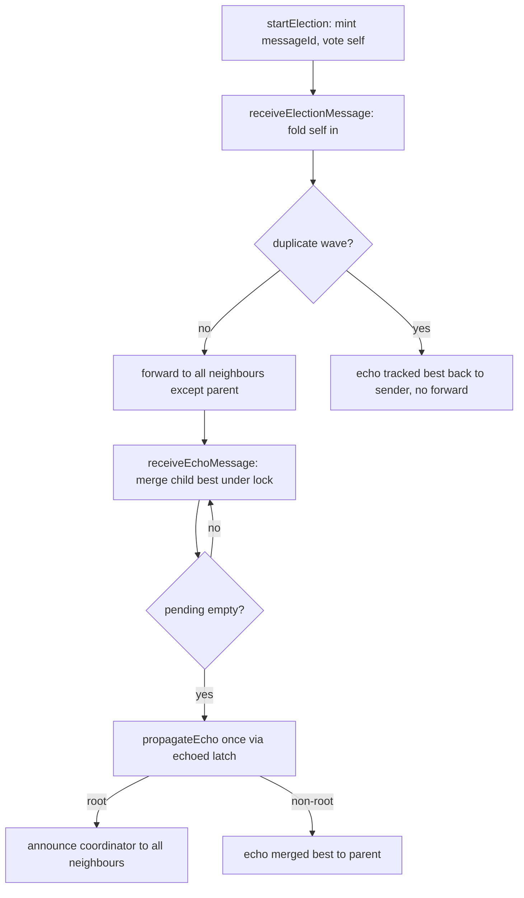

# Election Protocol

Echo-based flood over RMI neighbours (`src/main/java/com/cs324/worker/WorkerRemoteImpl.java`).



1. **Propagation.** `startElection()` mints `messageId = (id << 32) | electionCounter`, votes `(self, JAC)`, sets `pendingChildren = all neighbours`, forwards via `receiveElectionMessage`. Each hop folds itself in, then forwards to every neighbour except the parent (`originId`); unreachable neighbours are removed from `pendingChildren` so they cannot stall the wave.
2. **Duplicates answered, never dropped.** Dedup guard is the `elections: Map<Long, ElectionState>` claimed atomically with `compute()` — `seenMessageIds` is audit-only. A repeat wave reads the tracked best under `synchronized` and calls `receiveEchoMessage` back to the sender, then returns without forwarding. Silence would stall the sender, which only retires a neighbour on its echo (triangle topology proves this: two nodes forward to each other and must answer or both wait forever).
3. **All reachable workers considered.** Echoes merge under `synchronized(election)` with the same winner rule; each child is crossed off `pendingChildren`. The wave completes only when the set empties, then `propagateEcho` fires exactly once per wave via the `echoed` latch. Non-root nodes relay upward; the root decides.
4. **Winner rule: lowest JAC wins, highest ID breaks ties.** Applied identically on forward (`receiveElectionMessage`) and on merge (`receiveEchoMessage`):
```java
if (currentJac < bestJac) { bestId = this.id; bestJac = currentJac; }
else if (currentJac == bestJac && this.id > bestId) { bestId = this.id; bestJac = currentJac; }
```
5. **Coordinator announced.** Root sets `currentCoordinatorId`, uses `coordMessageId = messageId + 1000000` (never collides with a wave id), pre-records it in `seenCoordinatorMessageIds` before broadcasting, then calls `receiveCoordinatorMessage` on all neighbours. Announcements use a separate set from waves: first sighting is applied + relayed, repeats are dropped without relay so a cyclic broadcast terminates. A joiner uses `adoptCoordinator()` (local only, no relay) so adoption never reads as a new term.
6. **5-job term.** `Constants.JOBS_PER_TERM = 5`. `submitJob()` calls `reserveTermSlot()` (CAS increment, spend on accept not completion); over-budget or `handoverInProgress` jobs are refused with a retryable `RemoteException` and the job id is released for client retry. `maybeRotateCoordinator()` CAS-resets `5 -> 0`, sets `handoverInProgress`, and calls `startElection()` exactly once. The winner resets `termJobsCoordinated = 0` on announcement; through 4 jobs the leader is kept, on the 5th it rotates to the lowest-JAC worker.

Verify with `mvn "-Dtest=WorkerElection*,WorkerEcho*,WorkerDispatch*,WorkerCoordinatorMessage*" test`.
